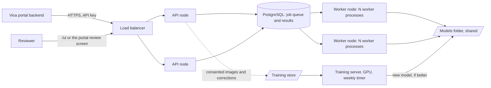

# Architecture

Offline document reader for the visa portal. It takes a photo or scan of a travel document and returns the fields,
check results, and whether a person must review it. Nothing leaves the server: there are no outbound calls at run time.

Status on 11 Nov 2026: supervised pilot. See `GO_LIVE_PLAN.md` for what is still open, and `SERVER_SIZING.md` for
hardware.

## 1. Overview

| Part | What it does | Code |
|---|---|---|
| API | Accepts uploads, validates and reduces images, creates jobs, serves results, takes reviewer corrections | `app/main.py`, `app/uploads.py`, `app/security.py` |
| Job store | Queue and results. PostgreSQL in production (`DATABASE_URL`); SQLite or memory for one machine | `app/pgstore.py`, `app/jobs.py` |
| Worker | Claims a job, runs the reading pipeline, writes the result | `app/worker.py`, `app/pipeline.py` |
| Readers (engines) | Find and read the text | `app/engines/` |
| Parsers and rules | Turn text into fields, verify check digits, decide review | `app/mrz.py`, `app/visual_zone.py`, `app/gcc_ids.py`, `app/validation.py`, `app/review.py` |
| Model registry | Lists models with checksums; one active model per task and language | `app/model_registry.py`, `models/manifest.json` |
| Training store | Images and corrections, only with applicant consent | `app/training_store.py` |
| Retraining | Scheduled fine-tune, scoring and gated switch | `training/auto_train.py`, `deploy/` |

## 2. How one read works

1. **Upload.** `POST /v1/documents/extract` with 1 to 4 JPEG or PNG images. The API checks the key, the rate limit,
   size, type (by content, not by label), pixel count and shape.
2. **Reduce.** A photo larger than `WORK_MAX_SIDE` (2000 pixels) is turned upright and reduced. A 12-megapixel phone
   photo otherwise takes about five times longer and four times the memory.
3. **Queue.** The job goes into the store and the API answers `202` with a `jobId`. With PostgreSQL the images sit in
   the queue until a worker takes them, and are erased the moment the job finishes. A running worker renews its claim, so
   only a job whose worker has stopped is given to another worker.
4. **Read.** The worker runs the engine chosen by `OCR_ENGINE`:
   - `ensemble`: Tesseract and RapidOCR read the page side by side. The page tilt is estimated first.
   - `auto` (default): PaddleOCR when it is installed with its models, with the pair above as fallback and second opinion.
   - Cards without an MRZ (Iqama, GCC IDs): the text reader (Arabic and English) reads rows, re-reads weak rows, fills
     dropped rows, and re-reads the ID number with digits only.
5. **Parse and verify.** MRZ lines are parsed to ICAO 9303 (TD1, TD2, TD3, MRV-A, MRV-B). Check digits are verified;
   look-alike characters (O/0, I/1) are repaired only where a check digit confirms the repair. Card text goes through
   the visual-zone parser and the national ID checks.
6. **Decide.** Fields that a check digit protects are trusted when it passes. Names, nationality, sex and issuing
   state have no check digit: they are accepted without review only when two independent readers produce identical
   lines with every check passing, or the applicant's form data confirms them. Cards without an MRZ always go to review
   unless `VISUAL_ZONE_AUTO_ACCEPT` is set.
7. **Result.** `GET /v1/jobs/{id}` returns the fields, each check, flags and `needsReview`. Results expire after
   `JOB_TTL_MINUTES` (60).

## 3. Speed controls

| Setting | Default | Effect |
|---|---|---|
| `WORK_MAX_SIDE` | 2000 | Longest image side used for reading |
| `OCR_DEADLINE_SECONDS` | 0 (off) | Hard limit per read; readers return the best reading in hand. Use 1.7 for a 2-second total |
| `OCR_SEARCH_SECONDS` | 8 | Tesseract search budget when there is no hard limit |
| `OCR_SECOND_READER_SECONDS` | 1.5 | RapidOCR stops improving a reading after this |
| `OCR_TEXT_SECONDS` | 20 | Limit for the card text reader when no hard limit is set. With a hard limit, that limit applies to cards too |

## 4. Learning loop

1. The reviewer ticks consent, reads the document, corrects the lines shown, and saves (`POST /v1/jobs/{id}/corrections`).
2. The training store keeps the image and the corrected lines for `TRAINING_RETENTION_DAYS` (30).
3. Weekly, `training/auto_train.py` checks for enough new lines, fine-tunes the PaddleOCR recognition model, and scores
   the new and the current model on the same real validation lines.
4. A better model is registered as a candidate, or activated when `--activate` is set. A worse one is never activated.
5. Running workers notice the changed `manifest.json` and load the new model on the next read. No restart.

Only the PaddleOCR recognition model learns. Tesseract and RapidOCR are fixed. The lite Docker image has no PaddleOCR,
so it does not benefit from retraining.

## 5. Data and privacy

| Data | Where | Kept for |
|---|---|---|
| Uploaded images | Queue row | Until the job finishes |
| Result (personal data) | Job store | `JOB_TTL_MINUTES`, default 60 |
| Raw text lines | In the result only when `INCLUDE_TEXT_LINES=1` | Same as the result |
| Consented images and corrections | Training store, owner-only files | `TRAINING_RETENTION_DAYS`, default 30 |
| Line crops and labels for a training run | Training work folder, owner-only | Deleted when the run ends |
| Logs | Standard output | No images, no field values |

Security controls (API keys, rate limits, TLS, headers) are in `SECURITY.md`.

## 6. Deployment shapes

| Shape | Use | How |
|---|---|---|
| One container | Demo, pilot with a few users | `docker run`, in-process reading, SQLite via `JOB_DB_PATH` |
| API + workers + PostgreSQL | Production | API containers with `WORKER_THREADS=0`; worker containers running `python -m app.worker`; shared `MODELS_DIR` |

Scale by adding worker processes. One worker reads one document at a time and uses about two cores while it does.

## 7. Known limits

- Accuracy is measured on generated documents only. Real-specimen results do not exist yet.
- US driving licences and state IDs (no MRZ) and old non-standard EU cards are not supported.
- Kuwait, Qatar, Bahrain and UAE card layouts are assumptions until real cards are tested.
- Not load-tested beyond a few parallel uploads.
- The real fine-tuning step has not run on a GPU with production weights.
- The rate limiter counts per API process, in memory. Behind a load balancer the effective limit is per node.
